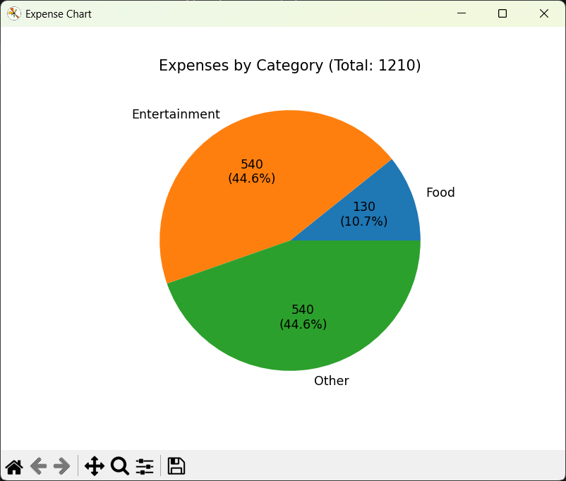

# SE_Assignment1 記帳軟體
## 安裝說明
```
git clone https://github.com/Neilo428/Se_HW01.git
```
## 執行程式
```
python input.py
```

## 輸入範例
```
nput format: date, amount, category, note (or Enter 'q' to quit)
Example: 2026-11-15,130,food,breakfast
Category:{'tran', 'ent', 'food', 'oth'}
> 2026-11-15,130,food,breakfast
```


### 輸入格式
- 日期date: YYYY-MM-DD
- 金額amount: 非0正整數
- 項目category: 
    - tran: 交通transport
    - ent: 娛樂entertainment
    - food: 食物food
    - oth: 其他other
> 中間需用逗號格開

### 錯誤輸入
- 日期、金額、項目不符合格式
- 未用逗號隔開
- 缺少日期、金額、項目

## output.py

- `show_chart(data)`:根據讀進的資料繪製圓餅圖,每次呼叫都會即時更新同一個視窗
- `keep_chart()`:輸入結束後,讓圖表視窗保持開啟
- 圓餅圖會顯示類別全名、金額、百分比、以及標題總金額

### 輸入以下資料後的結果
```
2026-11-15,130,food
2026-11-15,540,ent 
2026-11-15,540,oth
```

